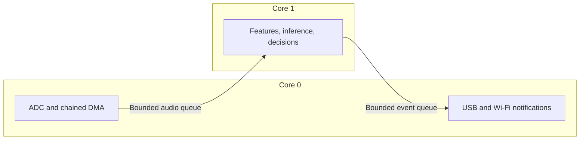

# Rust firmware

Status: running on Pico 2 W; short-run capture, inference, USB, and notifications
checked. Installed-room accuracy and long-term reliability remain unverified.
Recognition policy belongs in the [detection design](learned-doorbell-detection.md).

## Platform decision

| Choice | Reason | Cost or boundary |
| --- | --- | --- |
| Pico 2 W | An available replacement adds an FPU and CPU/RAM headroom, with compatible microphone wiring. | Requires its own firmware image; a Pico 1 binary cannot be reused. |
| Rust + [Embassy](https://github.com/embassy-rs/embassy/tree/main/examples/rp235x) | Express peripheral and buffer ownership while supporting USB, DMA, multicore, and Wi-Fi. | Rust does not prove foreign-code safety or real-time performance. |
| C++ TFLite Micro | Retain the exported integer model and upstream inference implementation. | Requires a controlled C ABI and numerical checks. |
| Model embedded in flash | Keep weights and matching preprocessing together without separate storage or provisioning. | Model updates require a firmware rebuild. |

Rust replaces TinyGo while retaining the MAX9814 microphone and ntfy notifications.
Changing the firmware language alone does not require retraining.

## Runtime architecture

Synchronous inference does not yield to the
[Embassy executor](https://github.com/embassy-rs/embassy/blob/main/docs/pages/runtime.adoc).
Separate cores keep it from blocking capture and networking, at the cost of
cross-core synchronization and another stack. Notification retries must not block capture.

### Continuous audio and state

- **Acquisition:** use hardware-paced, chained DMA with bounded circular buffers.
  The [inspected batch ADC driver](https://github.com/embassy-rs/embassy/blob/e23bc27945d76f94a4051b2f96ccd08dc7abdb26/embassy-rp/src/adc.rs)
  stops between acquisitions. Discard a copy if DMA catches the reader.
- **Features:** compute each FFT/mel frame once and retain quantized features in a
  ring. Use the FPU and omit zero filter weights, preserving the training definition.
- **Audio loss:** report capture faults and queue overflow separately. Clear sample
  overlap, cached features, and pending detection evidence; retain an accepted
  event's cooldown so recovery does not produce a duplicate alert.
- **Timing:** use captured sample positions for pattern age and cooldown. Keep FFT
  and prediction windows on one grid; cadence changes require policy re-evaluation.

### Resource budget

Budget feature buffers, inference workspace, both stacks, and Wi-Fi together.
Static allocation checks do not establish actual stack use or sustained throughput.

Measure incremental feature work and inference with capture, Wi-Fi, and notifications
active. Separate startup from steady operation. The whole path must fit the prediction
interval with headroom and no sustained audio loss; larger queues only absorb jitter.

Spend available headroom on better notification accuracy. Compare wider and narrower
models on the same validation data and repeat device profiling for replacements.
If the complete path cannot fit, reconsider cadence or hardware.

## Native runtime boundary

Follow the [TFLite Micro porting guide](https://github.com/tensorflow/tflite-micro/blob/main/docs/new_platform_support.md)
with pinned, release-built reference kernels.

| Boundary | Design rule |
| --- | --- |
| Interpreter ownership | One Rust owner; C++ objects stay private behind checked buffers and status returns through a [C ABI](https://docs.rust-embedded.org/book/interoperability/c-with-rust.html). |
| Allocation | Use aligned static working memory and only required operations. Disable C heap growth to protect audio and stack budgets. |
| Board runtime | Rust owns startup, interrupts, and peripherals. Match Rust/C++ floating-point ABIs and the RP2350 boot image requirements. |
| USB peripheral memory | Scope byte-copy wrappers to USB memory: optimized C copies can emit unaligned accesses rejected for [Cortex-M33 Device memory](https://datasheets.raspberrypi.com/rp2350/rp2350-datasheet.pdf). |
| Intrinsic overrides | Avoid global ROM replacements; inspected RP2040 aliases broke 64-bit runtime helpers. Keep ordinary inference-buffer copies optimized. |

Exported feature and inference references check this boundary on the host and at
device startup. Microphone accuracy and execution time require separate checks.

## Builds, model updates, and secrets

### Ownership

- `firmware/` owns embedded Rust, native glue, and the checked-in default model bundle.
- `ml/` owns Python training, evaluation, tests, and project settings. Both projects
  keep their own source trees and dependency locks; data and the Nix environment
  are shared. Large experiment artifacts remain separate. Preserve TinyGo in Git
  history rather than a second maintained tree.
- Nix pins native tools and C++ sources; Cargo locks Rust; uv owns Python. Each
  dependency set has one owner, avoiding a second Python environment definition in Nix.

Flake apps run build, flash, attachment, and monitoring in the user's environment.
Windows tools and USB devices are WSL runtime dependencies outside Nix build sandboxes.

### Model updates

Build and evaluate candidate bundles independently of the default. Promote matching
weights, frontend coefficients, labels, quantization, and policy as one verified unit.
Verify hashes and reference data for the complete bundle; missing checksums fail
verification. Retain the previous bundle for recovery.

### Credential handling

Protect credentials from accidental exposure in source, build intermediates, UF2
images, and development logs. Physical extraction and malicious replacement
firmware are outside this installation's threat model.

The board generates its private key with the RP2350 hardware random generator and
keeps it in a flash sector excluded from the firmware image. Only its public key
is exposed over USB. At initial setup or credential changes, a short-lived process
uses SecretSpec and Windows 1Password authentication to encrypt the credentials.
It returns only ciphertext; plaintext never enters Cargo, Nix, command arguments,
or generated files. The PC necessarily handles plaintext briefly in process memory.

Use [libsodium sealed boxes](https://doc.libsodium.org/public-key_cryptography/sealed_boxes),
with RustCrypto on the device. Retain the public key and ciphertext in version
control and embed that ciphertext in subsequent firmware builds. The board checks
integrity and decrypts at startup; missing or invalid settings disable networking
while capture, inference, and USB diagnostics remain available.

| Action | Credential policy |
| --- | --- |
| Initial setup or credential change | Retrieve from 1Password and encrypt for the board's public key. |
| Build, check, and flash | Reuse the saved ciphertext without plaintext or vault access. Preserve the device key. |
| Monitor | Expose diagnostics and the public key, never credentials or the private key. |

The encryption script and dependency lock preserve the procedure. Re-encrypting
the same settings intentionally produces different ciphertext because sealed
boxes use fresh randomness; the saved ciphertext is the reproducible build input.
Losing the device key, fully erasing flash, or changing boards requires obtaining
the new public key and encrypting again. No private-key backup is kept on the PC.

The private key remains readable to firmware with unrestricted device access.
This design does not require irreversible OTP settings or secure boot and does
not defend against a full device-memory extraction. Protecting against a malicious
PC process with access to 1Password would require a separate access-control policy.

Notifications currently use unauthenticated HTTP. Wider deployment requires
revisiting transport and device-access protections.

## Alternatives considered

| Alternative | Decision |
| --- | --- |
| Pico 1 with fixed-point FFT | Reference features matched, but measured throughput still fell short. Prefer the available Pico 2 W's FPU. |
| Narrower models | Speed savings did not justify the observed loss of detection quality. |
| [MicroFlow](https://github.com/matteocarnelos/microflow-rs) | Rust inference could remove C++ linking; model compatibility, numerical agreement, memory, and speed remain unverified. |
| [tfmicro bindings](https://github.com/Recognition2/tfmicro) | The inspected bindings pinned an old runtime, so they were not the starting point. |
| [Pico TFLite Micro port](https://github.com/raspberrypi/pico-tflmicro) | Some inspected kernels used both cores, conflicting with the chosen core ownership. |
| Linux Raspberry Pi | More runtime headroom, with OS maintenance costs. Reconsider if Pico cannot meet accuracy or resource needs. |

## Verification scope

1. **Numerics:** compare Rust features and C++ predictions with exported references;
   exercise the model at device startup.
2. **Continuous operation:** check ADC/DMA handover, sample scaling, cross-core state,
   memory use, and cadence while inference and networking are active.
3. **Notification path:** check delivery, reconnects, and retries; measure transport
   delay separately from audio-time detection and computation.
4. **Credentials:** host tests check encryption compatibility and reject wrong keys
   or damaged ciphertext. First-boot key generation, retention across a normal UF2
   update, and Wi-Fi connection using the decrypted settings have been checked on
   Pico 2 W. Full flash erasure requires generating a new key and re-encrypting.

Diagnostics distinguish class scores, satisfied detection conditions, accepted
events, and notification delivery. A high score alone does not establish an alert;
server acceptance does not establish that a phone displayed it. Keep credentials
and notification targets out of diagnostic output.

Report the proportion of samples at the ADC limits alongside signal level. Digital
filtering can suppress low-frequency interference but cannot repair input clipping;
persistent clipping requires checking the microphone gain, supply, and wiring.

On request, export a bounded ADC trace so host comparisons use the same microphone
input as the device. Preserve sample order and reject missing records; replay must
not conceal acquisition or transport gaps. Capture stays off during normal operation
and must fit the processing budget when enabled.

Keep model identity, conditions, measurements, and scope with the verification record.
A build or successful development flash does not establish installed-room accuracy
or long-term reliability. Those remain separate from short device checks under the
[detection design](learned-doorbell-detection.md).
